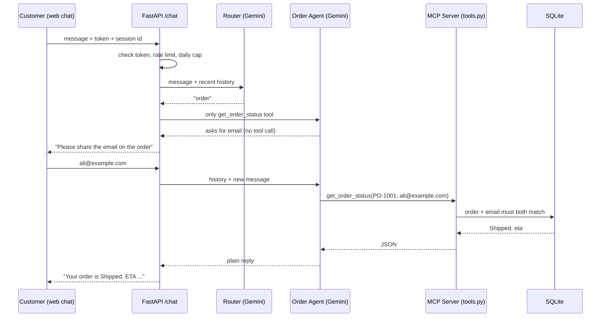
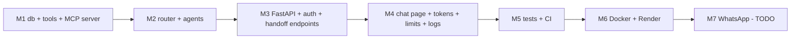

# Trade Desk Agent

Customer chat assistant for cables, inverters, breakers and solar panels.
Quotes, prices and discounts always go to a human sales rep (handoff).

## Files (simple map)
| File | Kaam |
|---|---|
| `db.py` | SQLite tables + SAMPLE data (real data baad mein) |
| `tools.py` | Saari business rules (stock in words, order needs email, idempotent handoff) |
| `trade_server.py` | MCP server, tools.py ko 4 tools ki shakal deta hai |
| `agents.py` | Router + 4 agents + MCP client + Gemini |
| `api.py` | FastAPI: `/chat`, `/handoffs`, `/health`, chat page |
| `limits.py` | Rate limit + daily model-call cap |
| `logs.py`, `utils.py` | JSON logs, private data masking |
| `static/chat.html` | Simple chat page |
| `tests/` | 25 tests (tools + agents with fake model) |

## Algorithm: Router pattern (not plan-first)
1 LLM call picks ONE agent, that agent answers. Total 2-3 model calls per message
(plan-first with writer + reviewer would be 4-6). Cheaper and faster.
**Trade-off:** one message = one agent. "Stock check + order status" in one sentence
is handled only partly. Short chat history (last 6 messages) helps follow-ups.

## Flow (example: "Where is my order PO-1001?")


## Milestones (summary)

- **M2:** Router + Catalog/Order/Handoff/General agents. Each agent gets only its own tools.
- **M3:** `POST /chat` (X-API-Key, validated input), `GET /handoffs`, `POST /handoffs/{id}/claim|close` (admin key).
- **M4:** `/?token=...` link per client, 10 req/min per token, daily model-call cap, JSON logs with request id and llm_calls, emails/phones masked.
- **M5:** 25 tests, fake model (no Gemini needed), GitHub Actions.
- **M6:** Dockerfile, docker-compose, render.yaml.

## Run on your machine
```bash
cd ~/Downloads/"PROJECTS PRODUCTION"/trade_desk
python3 -m venv venv && source venv/bin/activate
pip install -r requirements.txt
cp .env.example .env        # then edit .env (key, tokens)
python3 -m unittest discover -s tests -t . -v      # tests
python3 smoke_test_server.py                       # MCP server check
uvicorn api:app --reload                           # start API
```
Open `http://localhost:8000/?token=client-token-one`.

Sales rep check:
```bash
curl -H "X-API-Key: <ADMIN_API_KEY>" localhost:8000/handoffs
curl -X POST -H "X-API-Key: <ADMIN_API_KEY>" localhost:8000/handoffs/1/claim
```

## Docker
```bash
docker compose up --build
```

## Deploy on Render (free)
1. Push code to GitHub (commands below).
2. render.com -> New -> Blueprint -> select the repo (uses `render.yaml`).
3. Set secrets in Render: `GEMINI_API_KEY`, `CLIENT_TOKENS`, `ADMIN_API_KEY`.
4. Open `https://<your-service>.onrender.com/?token=<one of CLIENT_TOKENS>`.

**Free tier limits (honest):** service sleeps when idle (first request is slow), and the
database file in `/tmp` is erased on restart (handoffs are lost, sample data returns).
For real use: Postgres (Neon/Supabase) or a paid disk. Check Render pricing page before deploying, free tiers change.

## Git commands
```bash
git init
git status                 # .env, venv, *.db NAZAR NA AAYEN
git add .
git status                 # dobara check
git commit -m "Trade desk agent: milestones 2-6"
git branch -M main
git remote add origin https://github.com/<you>/trade-desk.git
git push -u origin main
```

## Interview questions (short answers)
1. **Why a router and not plan-first?** Most messages need one agent. Router = fewer LLM calls, less cost and delay. Weak at multi-step questions.
2. **Why are business rules in tools.py and not in prompts?** Code is testable and cannot be talked around by the customer. Prompts can be ignored by the model.
3. **Why same error for wrong email and missing order?** So nobody can discover which order IDs exist.
4. **What is idempotent handoff?** Same contact + same summary while open returns the same reference, so retries do not create duplicates.
5. **Why least privilege for tools?** An agent that cannot see a tool cannot misuse it.
6. **Why mock the model in tests?** Fast, free, repeatable. It proves wiring (routing, tool loop, limits), NOT Gemini's answer quality.
7. **Why are MCP tools async?** langchain-mcp-adapters tools are async only, so we use `ainvoke` and `asyncio`/FastAPI async.
8. **What limits the rate limiter?** It is in memory: resets on restart and works for one server only. Use Redis for many servers.

## What was NOT run (on my side)
- Real Gemini calls, real MCP server start, FastAPI server, Docker, Render. (No internet/packages here.)
- Run on your machine: `smoke_test_server.py`, `uvicorn api:app`, chat in browser.
- Verified here: 25 unit tests (tools, masking, routing/tool loop with fake model).
- Unverified guess: `MultiServerMCPClient` config keys (`transport`, `env`) can differ by library version. If `get_tools()` fails, send me the error.
